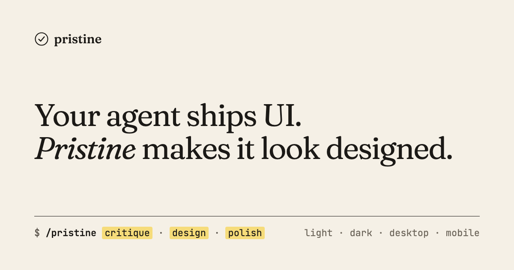

# Pristine

[](https://github.com/maddhruv/pristine/actions/workflows/ci.yml)
[](LICENSE)
[](https://skills.sh/maddhruv/pristine)



An agent skill that makes web UI pristine. It looks at the real page (light and dark, desktop and mobile), judges it through the eyes of the people who use your product, and either scores it honestly or fixes it.

Works with Claude Code, Codex, GitHub Copilot, Cursor and any agent that reads `SKILL.md`.

**Site and examples:** https://pristine.pages.dev

| Before (3.5/10) | After one `/pristine polish` (9.5/10) |
| --- | --- |
|  |  |

Eight real before/after pairs, with the full critique and every change: https://pristine.pages.dev/#examples

## Commands

| Command | What it does | Edits code |
| --- | --- | --- |
| `/pristine init` | Reads your code, asks only what it can't see, and writes `DESIGN.md`: product, Personas, brand, design system. | yes |
| `/pristine critique <target>` | Scores a page out of 10 across 11 Dimensions, through each Persona, with the exact fix for every finding. | no |
| `/pristine design <brief>` | Builds a new page, component or flow, or redesigns one in a new direction. | yes |
| `/pristine polish [lenses] <target>` | Keeps the look and raises every detail. The default for a bare `/pristine` on existing UI. | yes |

A target can be a URL, a pasted screenshot, a file path or a feature name. Name Lenses after `polish` to force them, for example `/pristine polish bolder typeset the hero`. There are 16: bolder, colorize, typeset, quieter, decolorize, distill, layout, adapt, consistency, animate, delight, overdrive, clarify, harden, optimize, polish-details.

Full reference with examples: https://pristine.pages.dev/docs/

## Install

### Claude Code

```
/plugin marketplace add maddhruv/pristine
/plugin install pristine@pristine
```

### Codex

```bash
codex plugin marketplace add maddhruv/pristine
codex plugin add pristine@pristine
```

### GitHub Copilot (CLI and VS Code)

```bash
copilot plugin marketplace add maddhruv/pristine
copilot plugin install pristine@pristine
```

### Any agent (skills.sh)

```bash
npx skills add maddhruv/pristine
```

### By hand

```bash
git clone https://github.com/maddhruv/pristine ~/pristine
ln -s ~/pristine/skills/pristine ~/.claude/skills/pristine   # or ~/.copilot/skills, ~/.agents/skills
```

Then, in your project, run `/pristine init` once and `/pristine` on whatever you're building.

### Screenshots

Pristine captures pages before it judges them. It uses a browser tool your agent already has (Claude in Chrome, an agent browser, Playwright MCP). If there is none, `scripts/capture.mjs` installs a private Playwright Chromium into `~/.cache/pristine-capture` on first run. Node 18+ is required for the bundled scripts.

## Repository layout

```
skills/pristine/
  SKILL.md              entry point: commands, routing, non-negotiables
  agents/openai.yaml    display metadata for Codex
  reference/            one file per command, plus capture, craft floor
  reference/lenses/     the 16 Lenses
  reference/patterns/   landing pages, dashboards, onboarding, motion recipes, ...
  scripts/capture.mjs   light/dark x desktop/mobile screenshots, zoom, element capture
  scripts/detect.mjs    static scan for common UI defects
site/                   the showcase (Astro, Cloudflare Pages), built with Pristine
.claude-plugin/         plugin and marketplace manifests
```

## Contributing

See [CONTRIBUTING.md](CONTRIBUTING.md) and the [Code of Conduct](CODE_OF_CONDUCT.md). Bug reports that include the session, the harness and the model are the most useful thing you can send.

## License

[Apache-2.0](LICENSE)
